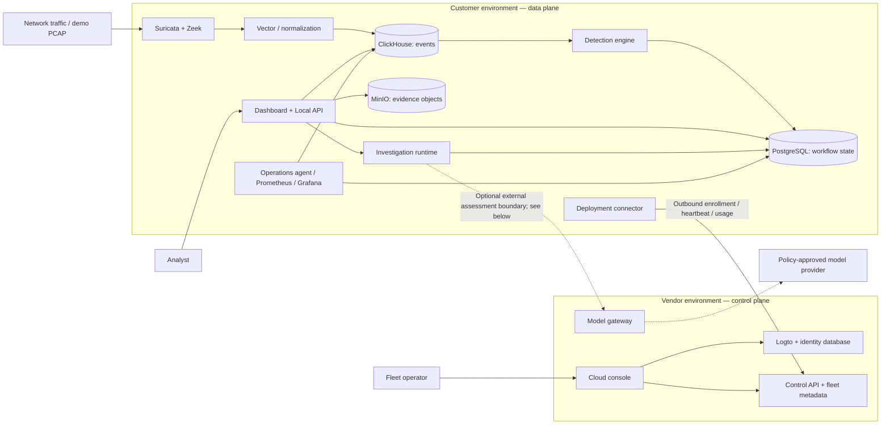
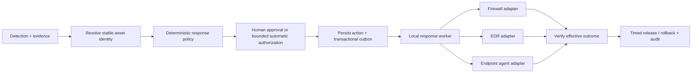

# AegisNDR — Hybrid AI Network Defense Platform

A runnable MVP of a customer-resident Network Detection and Response platform with a vendor-hosted control plane. The implementation follows the two product specifications in the parent workspace and demonstrates the primary product promise:

> Install locally, manage centrally, keep security data under customer control.

## What works

- Analyst dashboard with traffic, alerts, investigations, evidence citations, cases, sensors, AI transmissions, audit, and system settings.
- Local detection for port scans, DNS-volume/tunneling signals, traffic spikes, new destinations, and Suricata alert conversion.
- Local evidence collection, redaction, minimized evidence packaging, structured assessment validation, and an inspectable transmission ledger.
- Offline-safe investigations: detection and local findings continue when the model gateway is unavailable.
- Tenant-scoped local APIs and role/permission enforcement for analyst, auditor, administrator, read-only, and deployment-agent roles.
- Self-hosted Logto with organization RBAC, deterministic manifest/bootstrap, strict JWT/JWKS validation, and an isolated identity database.
- Control-plane enrollment, single-use enrollment tokens, heartbeat, entitlements, model policy, and metadata-only usage metering.
- Vendor cloud console with Logto organization authentication, customer and deployment enrollment, fleet health/version/sensor status, aggregate usage, entitlements, policy, updates, and support metadata—without customer event or evidence access.
- Single-node Docker Compose topology for the application plus Suricata, Zeek, Vector, ClickHouse, PostgreSQL, MinIO, Logto, Grafana, and Prometheus.
- Deterministic demo fixtures and automated unit, integration, security, and tenant-isolation tests.
- Opt-in response workflow with simulation, independent approval, bounded automatic policy, a supervised worker, Linux nftables gateway/endpoint enforcement, and a scoped Defender adapter with independent probe verification.

## System design

AegisNDR separates the **customer data plane** from the **vendor control plane**.
The customer appliance owns collection, detection, evidence, investigations, and
the analyst experience. The vendor services manage deployment identity, fleet
health, entitlements, and update metadata. Docker Compose provides a single-node
deployment with separate `customer` and `vendor` profiles; the customer installer
does not install the vendor services on the appliance.



The dotted assessment path describes the external model integration boundary.
The current Local API constructs an in-process `ModelGateway` with
`DeterministicAssessmentProvider`; deploying the standalone gateway does not
automatically connect local investigations to an external provider. The gateway
service has its own provider routing and privacy checks.

### Design decisions

- **Local operation first:** ingestion and detection do not depend on an LLM or
  a working vendor connection. Local findings and stored evidence remain available
  when an external assessment is unavailable.
- **Separate management and evidence paths:** the deployment connector sends
  fleet metadata and aggregate usage. It has no connection to the private
  `local-data` Docker network. Evidence assessment uses a separate, minimized
  package boundary.
- **Storage by workload:** ClickHouse handles event analytics, PostgreSQL holds
  transactional workflow state, and MinIO holds evidence objects. Named volumes
  preserve these stores across container replacement.
- **Explicit deployment limits:** this is a single-node topology. Restart
  policies improve recovery after process or Docker restarts; they do not provide
  host redundancy, backups, or automatic recovery from every unhealthy state.

## Architecture

### Components and responsibilities

| Component | Location | Responsibility |
|---|---|---|
| Suricata and Zeek | Customer | Network signatures and protocol metadata; deterministic PCAP replay in demo mode |
| Vector | Customer | Normalize sensor logs and checkpoint delivery to ClickHouse |
| Detection engine | Customer | Rules, baselines, alert generation, deduplication, and persisted progress |
| ClickHouse | Customer | Searchable network events and analytical queries |
| PostgreSQL | Customer | Alerts, cases, investigations, policies, and detection state |
| MinIO | Customer | Evidence, packet captures, exports, and support objects |
| Dashboard and Local API | Customer | Analyst workflows, tenant authorization, evidence access, and audit |
| Investigation runtime | Customer, inside Local API | Bounded evidence tools, redaction, assessment validation, and citations |
| Deployment connector | Customer | Enrollment, authenticated heartbeats, cached configuration, and metadata exchange |
| Update agent | Customer | Signed release manifest and artifact integrity checks; host installation is a separate installer action |
| Operations and observability services | Customer | Store health, ingestion lag, detection progress, retention, metrics, and dashboards |
| Logto and identity PostgreSQL | Vendor | OIDC, organizations, roles, and identity administration |
| Cloud console and Control API | Vendor | Organization-scoped fleet management, enrollment, entitlements, and policy/update metadata |
| Model gateway | Vendor | Approved assessment routing, privacy-policy enforcement, and usage metering |

### Main data flows

1. **Collect and detect:** sensors emit logs; Vector normalizes and ingests events
   into ClickHouse. The detection engine reads events, evaluates rules and
   baselines, and persists alerts and progress in PostgreSQL. Alert deduplication
   and checkpoint updates use transactional persistence.
2. **Investigate:** an authorized analyst opens an alert through the Local API.
   The investigation runtime gathers allowlisted local evidence, redacts and
   minimizes its assessment package, and validates structured findings and
   evidence references before recording the result. Current demo assessments
   use the deterministic provider described above.
3. **Manage the fleet:** the appliance enrolls with a single-use token and obtains
   a deployment identity. Subsequent connector requests use that identity to
   exchange health, usage, entitlement, and configuration metadata. The cloud
   console exposes fleet management without providing customer event searches.
4. **Observe and recover:** local monitoring checks service availability and
   processing progress. Persistent services use `restart: unless-stopped`;
   initialization jobs remain one-shot. Operators use health checks and metrics
   to distinguish a running process from a functioning ingestion pipeline.

### Trust boundaries and failure behavior

- Production analyst access uses verified JWTs and tenant/deployment permissions.
  Machine credentials are restricted to machine endpoints. Standalone installation
  supports local identity without a vendor control plane.
- The production HTTPS overlay exposes the dashboard, `/api/`, and `/grafana/`
  through a host-locked TLS origin. Databases and object storage stay private;
  the base Compose configuration is for explicit local development.
- Raw events and evidence remain customer-local. An external assessment may
  receive only a policy-approved minimized package. The model gateway fails
  closed when required regional or zero-retention policy cannot be verified.
- Vendor unavailability does not stop local detection. Assessment failures retain
  local findings; cached entitlement policy governs restricted model/update
  operations. Persisted ingestion and detection checkpoints support resumption.
- Restart policies take effect when a container exits; Docker does not restart a
  container solely because its health check reports `unhealthy`. Volume backups,
  restore procedures, and host capacity remain operational responsibilities.

### Blocking and endpoint isolation

**Implemented and opt-in; response defaults to off.** The Local API and Response
dashboard provide scoped asset registration, simulation, independent approval,
bounded automatic policy, exact proposal review, recovery controls and a separate
response journal. A supervised worker can create policy-matched proposals from
current detections and execute configured adapters. Concrete support covers Linux
nftables gateways, native Linux endpoint isolation, and Defender isolation for
Windows 10/11 with a separately preserved verification channel. Other products
and native endpoint operating systems are not implied. See the
[response workflow and API](docs/architecture/response-workflow.md) and
[deployment and recovery guide](docs/deployment/response-enforcement.md).

Firewall blocking,
EDR isolation, and endpoint agents share a customer-local response
workflow, with enforcement performed by the relevant integration:



Start with simulation, then introduce approved actions before narrowly scoped
autonomy. The response path enforces stable device bindings, tenant-scoped
authorization, critical-asset exclusions, action limits, an emergency stop,
idempotent native commands, and reconciliation of uncertain outcomes. Model output
does not authorize enforcement. A passive network sensor requires an
enforcement integration to block traffic or isolate a device.

For additional context, see the [architecture notes](docs/architecture/architecture.md),
[Compose configuration](infra/compose/docker-compose.yml), and
[customer installation guide](docs/deployment/customer-installer.md).

## Quick start

### Local product UI

Node.js 22.14.0 or newer is required. If Node is not installed, install it
with your operating system package manager or [nvm](https://github.com/nvm-sh/nvm),
then run the repository setup check:

```bash
./scripts/setup-node.sh
```

```bash
npm install
npm run dev -- --host 0.0.0.0 --port 4173 --strictPort
```

The UI includes a complete demo journey and gracefully uses seeded local data when the API is unavailable.

### Local API and control plane

The backend uses the Python standard library so the demo can run without downloading Python dependencies.

```bash
python3 apps/local-api/app.py --host 127.0.0.1 --port 8080 --reset-demo
python3 apps/control-api/app.py --host 127.0.0.1 --port 8081 --reset-demo
```

### Automated verification

```bash
npm run build
npm run test:sites
python3 -m unittest discover -s tests -p 'test_*.py'
```

### Full single-node topology

For explicit local HTTP development, start the customer-resident data plane
with the base Compose file:

```bash
docker compose -f infra/compose/docker-compose.yml \
  --env-file infra/compose/.env.example \
  --profile customer up -d --build
```

That base-only path explicitly enables development HTTP and publishes ports
`4173` and `8080`; keep it on loopback or an isolated test network.
Production installation always adds `docker-compose.https.yml`, removes those
ports, and exposes a host-locked TLS origin on ports 80/443 with the dashboard
at `/`, Local API at `/api/`, and Grafana at `/grafana/`. The installer can
generate an exact-SAN private-LAN certificate or validate supplied enterprise
material. Databases and object storage remain private. See
[`docs/deployment/private-lan-https.md`](docs/deployment/private-lan-https.md).

The vendor-hosted identity and control services are isolated in a separate
profile:

```bash
docker compose -f infra/compose/docker-compose.yml \
  --env-file infra/compose/.env.example \
  --profile vendor up -d --build
```

Logto is then published on local ports `3011` (OIDC) and `3012` (Admin Console).
The organization-scoped cloud console is published on `4180`, and its
same-origin proxy can reach only human `/v1/portal/*` APIs. The control API and
standalone model gateway remain on `8081` and `8082` for the development
profile.
After its first start, complete the one-time Management API registration and
identity bootstrap documented in `infra/logto/README.md`.

## Repository map

```text
apps/                 Local and control-plane APIs
apps/cloud-portal/    Vendor metadata-only management console
services/             Detection, agent, model-gateway, and ingestion logic
packages/             Shared contracts, redaction, auth, and audit helpers
src/                  Customer-resident analyst dashboard
infra/                Compose and service configuration
installer/            Preflight, install, and verification scripts
tests/                 Unit, integration, security, and isolation tests
docs/                  Architecture, threat model, API, and demo guidance
```

## Security boundary

Raw events, packet captures, alert evidence, cases, analyst notes, and audit records remain in the customer environment. Only a policy-approved minimized evidence package can cross the outbound model boundary. The gateway stores usage metadata—not prompts, responses, or evidence—and fails closed when zero-retention or regional policy cannot be verified. Optional response integrations use a separate worker boundary: configured enforcement services receive exact target/action metadata, and Defender receives provider device IDs and correlated action comments. Provider credentials stay in customer-local secret files and are used only with configured authenticated TLS destinations.

Blocking and endpoint isolation require explicit response configuration, valid
credentials, an enabled worker and local policy. They are disabled in the base
deployment. Live acceptance and enablement are separate from source delivery.

## Customer appliance installation

Use the signed, customer-only installer workflow in
[`docs/deployment/customer-installer.md`](docs/deployment/customer-installer.md).
It covers online and offline bundles, checksum/signature verification before
privilege, single-use enrollment, local P-256 identity, idempotent upgrades,
post-install health checks, and data-preserving uninstall. The installer never
deploys vendor Logto or the vendor control API on the customer device.


## Live traffic view and alert-only operation

Suricata and Zeek can capture directly from the selected Linux interface with
`SENSOR_CAPTURE_MODE=live`, `SENSOR_NETWORK_MODE=host` and `CAPTURE_INTERFACE`.
Capture uses NET_RAW only, with a read-only filesystem and no-new-privileges;
NET_ADMIN is not granted. Suricata uses UID 0 because Docker clears effective
capture capabilities for a nonroot UID. Its image makes only the vendor's public
configuration files readable, avoiding extra file-access capabilities.

The authenticated **Traffic** page reads the latest 100 indexed observations
within five minutes every three seconds. It shows a 60-second activity chart,
protocol and destination counts, sensor sources and a scrolling event table.
Pause/resume and explicit stale/disconnected states distinguish stored results
from a working feed. Counts describe the bounded event sample, not total link
throughput or packets per second. Flow completion and ingestion can add delay.

Passive capture observes only packets reaching the chosen interface. Monitoring
other LAN devices requires an authorized mirrored switch feed or gateway sensor.
Alerts are observations for review; automatic blocking/isolation remains off by
default and must not be enabled as part of setting up this view. A read-only Logto
role can view traffic and alerts without permission to change policy or respond.
