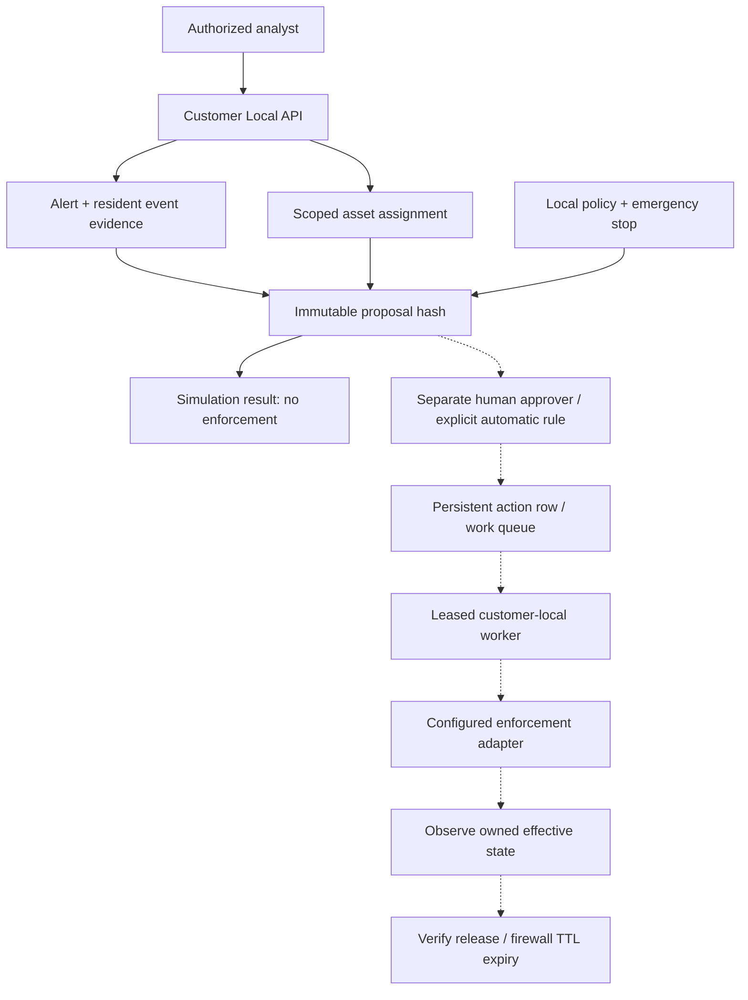

# Customer-local response workflow

## Delivery status

This change implements the **shared backend foundation** for firewall blocking,
EDR isolation, and endpoint-agent isolation. The default Local API supports policy,
asset registration, evidence-bound proposals, simulation, action inspection, and
an emergency stop. It starts with response **off** and live execution disabled.

The Response dashboard now supports policy and asset setup, individual and
recent-alert simulation, proposal review, permission-based action controls, and
the separate response journal. Its preview mode is read-only and explicitly
displays that no response is performed. Read failures disable mutation controls.

The approval lifecycle and leased worker are library components for the next lab
integration stage. No firewall/EDR/agent adapter, privileged worker service, or
live configuration switch is installed by this change. Setting an API policy to
a live mode is rejected by default. This is not
a claim that all three families can already enforce containment.

## Flow and boundaries



Solid arrows show the default API path. Dotted arrows require the lab adapter and
worker integration. The response runtime does not call the model, take a model
confidence as permission, execute a shell, or accept a provider URL or credential
from a request.

## Policy and asset identity

Policy modes are `off`, `simulate`, `approval_required`, and `autonomous`.
The default policy has no allowed device groups or response families. Updates
require the current integer `version`; each change increments it. An emergency
stop increments the version and prevents subsequent authorization. It does not
undo existing restrictions or revoke an operation already submitted externally.

Automatic authorization requires an exact match of detector ID, severity
(`high` or `critical`), device group, and response family against an explicit
local rule. Assessment text and model confidence are not inputs to this decision.
Automatic authorization is implemented for a submitted proposal. A manual batch
can simulate up to 50 recent alerts (20 by default) against registered assets and
permitted bindings, reporting excluded alerts separately. Batch proposals are
forced to simulation inside the authorization transaction; a concurrent switch
to a live mode cannot turn a batch simulation into enforcement. Automatic
creation of proposals from the detection loop is a later integration step.

An administrator registers a stable asset ID, group, platform, critical flag,
mapping source, current addresses, assignment start/end, and provider bindings.
A binding contains an `integration_id` and a stable provider `target_id`.
Assignments must cover both evidence time and current time, last at most 24
hours, and not overlap another current asset's addresses. The registry is an
administrator-attested mapping, not an implemented DHCP/EDR inventory discovery
service. Shared/NAT addresses require authoritative disambiguation upstream.

Proposals are denied for critical assets, excluded groups/families, missing or
stale evidence, expired mappings, closed alerts, or a target that is not the
alert entity. An address merely appearing elsewhere in the evidence is not
enough to authorize a response against it.

## API

All paths are under `/api/v1/response`. Tenant and deployment come from the
existing verified authentication boundary, not from proposal body fields.

| Method and path | Permission | Purpose |
|---|---|---|
| `GET /capabilities` | `response:read` | Report families, registered adapters and execution gate |
| `GET /policy` | `response:read` | Read current policy and version |
| `PATCH /policy` | `response:manage` | Update policy using its current version |
| `POST /emergency-stop` | `response:stop` | Stop new response enforcement |
| `GET /assets` | `response:read` | List scoped asset assignments |
| `POST /assets` | `response:manage` | Register or replace an asset assignment |
| `GET /actions` | `response:read` | List scoped action records |
| `POST /actions` | `response:propose` | Propose an evidence-bound action or simulate it |
| `POST /simulations` | `response:propose` | Simulate recent alerts; body includes `request_id` and optional `limit` (1–50) |
| `GET /actions/{id}` | `response:read` | Inspect proposal, authorization and observed outcome |
| `POST /actions/{id}/approve` | `response:approve` | Approve the exact proposal hash as a different person |
| `POST /actions/{id}/cancel` | `response:propose` | Cancel an own unstarted action; cancelling others also requires approval permission |
| `POST /actions/{id}/release` | `response:release` | Request verified recovery of an owned restriction |
| `GET /journal` | `response:read` | Read the separate response journal |

Capabilities also include the authenticated actor ID and server-side permissions
so the dashboard can distinguish the proposer from an independent approver.
The server checks permissions again on every mutation.

Lists support `limit` (1–500, default 100) and `offset`. Policy denials return
`409 response_denied`; missing permissions return `403`; inaccessible records
return `404`. Request bodies reject unknown fields.

To start simulation, an administrator updates the policy with the current
`version`, `mode: "simulate"`, and explicitly allowed groups and families. The
supported family/action pairs are `firewall` / `block_address`, `edr` /
`isolate_endpoint`, and `agent` / `isolate_endpoint`.

An action request has this shape:

```json
{
  "request_id": "unique-client-request-id",
  "asset_id": "lab-workstation-01",
  "alert_id": "existing-local-alert-id",
  "family": "firewall",
  "address": "192.0.2.10",
  "duration_seconds": 300
}
```

Use actual, current local evidence and a registered assignment. Reusing the same
request ID and body returns the original action; a changed body is rejected.
Simulation returns `status: "simulated"`, a proposed scope, and
`enforcement_performed: false`. It is not verification of an actual block.

Approval/cancel/release bodies contain only `proposal_hash`. Approval is bound
to the target, asset revision, complete alert state, evidence content, policy version, duration,
direction, integration configuration revision, and authorization expiration. Any relevant change requires a new
proposal. A proposer cannot approve their own action.

New scopes are declared in the Logto manifest and intersected with server-side
role permissions. Reapply the identity bootstrap and obtain new scoped tokens
when deploying this feature. Deployment-agent credentials receive no response
permissions. The existing global audit page does not yet display this separate
response journal.

## Persistence, concurrency, and recovery

SQLite demo state and production PostgreSQL use the same scoped response record
layout. PostgreSQL migration 5 is additive and runs through the existing migration
mechanism. A schema lock serializes concurrent startup migrations. Per-deployment
transaction locks serialize proposal deduplication, capacity checks, approval,
and worker claims. The action row is the transactional outbox; no broker is
required.

Journal records and associated state mutations commit in the same transaction.
The journal is append-only through this API and hash-linked with an increasing
sequence. It is separate from the existing product audit chain; it is not an
external tamper-proof archive. Denials are journaled when storage is available;
an audit failure is logged and does not authorize an action.

Live lifecycle, once a trusted adapter is installed:

```text
awaiting_approval -> queued -> executing -> verifying -> succeeded
                                         \-> unknown (observe; never blind resubmit)
succeeded / unknown -> release_queued -> releasing -> release_verifying -> released
                                                  \-> release_unknown
```

Unstarted actions can become `cancelled` or `invalidated`. A 60-second worker
lease and unique token prevent another worker from submitting the same queue
item concurrently. An expired submission lease becomes `unknown`; the worker
only reconciles it. A provider submission ID is recorded separately from
effective state. HTTP acceptance alone cannot produce `succeeded`.

Adapters must expose a 64-character lowercase SHA-256 `revision` for their
nonsecret enforcement configuration. The proposal pins it; the worker refuses
to use a replacement configuration for submission, observation, or recovery.
Rotate credentials without changing the identity of the enforcement target.
Restoring access to the original integration is required to resolve a pinned
action after configuration changes.

Adapters must reconcile by the original action ID when a submission response is
lost, verify that observed restrictions belong to this action, and remove only
those restrictions. The worker observes ownership and current state before a
release request, including a human-requested retry. A late observation cannot
overwrite release intent. Disabling new execution still permits observation and
recovery through the original configured adapter. Only one unresolved/active
action per asset is allowed.
Firewall actions require enforcement-side expiration and read-back of expiry.
Endpoint isolation requires explicit verified release; its proposal duration
does not imply automatic endpoint recovery. Unknown outcomes remain active for
capacity limits and require observation or operator recovery.

The initial implementation supports at most 1,000 asset assignments, 100 active
actions, and a policy limit of 100 authorizations per hour. Bounded inventory and
rate-check windows fail closed when exceeded. Response history has no automatic
retention job yet. This is a single-node design with persistent storage, not a
high-availability response controller.

## Remaining integration and acceptance work

### Enforcement integration requirements

| Family | Required integration inputs | Required acceptance evidence |
|---|---|---|
| Firewall | Gateway product/API, enforcement zone, exact address assignment, management exclusions, and owned rule namespace | Rule read-back at the forwarding point, bounded expiration, IPv4/IPv6 behavior, and removal of only the action's rules |
| EDR | Product/API, stable provider machine ID, permitted device groups, local secret files, supported OS, and management path | Submission reconciliation, effective isolation read-back, unrelated restriction preservation, and verified release |
| Endpoint agent | Operating systems, enrolled device identity, typed command transport, replay/expiration policy, and recovery channel | Authenticated commands, no general shell tool, owned local restrictions, management reachability, and release after controller interruption |

A concrete EDR integration must account for provider-specific semantics. For
example, Defender's [isolation API](https://learn.microsoft.com/en-us/defender-endpoint/api/isolate-machine)
returns a machine action; its [action resource](https://learn.microsoft.com/en-us/defender-endpoint/api/machineaction)
has pending, in-progress, and terminal states. Submission acceptance is not
independent proof of effective isolation or ownership. Its documentation also
warns about management connectivity for devices behind a full VPN tunnel. These
are adapter acceptance requirements; this change does not install a Defender
adapter or send any provider requests.

### Rollout sequence

1. Select the lab firewall, EDR, and endpoint operating systems. Build concrete
   `validate`, `submit`, `observe`, and `release` adapters; load credentials from
   customer-local secret files and pin adapter configuration to approved proposals.
2. Add capability checks for supported platforms, enforcement zone, management
   connectivity, exclusions, provider ownership, and reliable rollback. Introduce
   an explicit deployment configuration and supervised worker only after these
   checks exist. The current library interface is not a production integration.
3. Connect selected detectors to proposal generation without giving the model
   execution authority. The dashboard controls now exist; validate their full
   lifecycle with each concrete adapter before enabling live operation.
4. Exercise tenant and role isolation, replay/staleness, real PostgreSQL races,
   worker crashes, lost submissions, provider throttling, IPv4/IPv6, and effective
   enforcement/release in a dedicated lab before enabling live modes.
5. Roll out approved actions first, then narrowly bounded automatic firewall
   rules, then endpoint isolation for explicitly opted-in groups.

No live containment or deployment changes are performed by this foundation.
